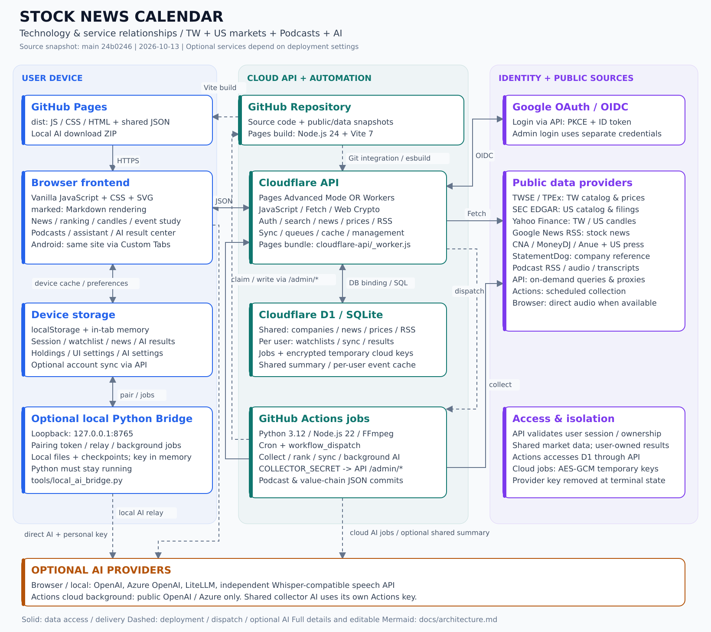

# 股聞日曆：技術與服務架構

本圖依 2026-10-13 的 `main`（`24b0246`）程式碼、工作流程與部署文件整理，涵蓋台股、美股、Podcast、AI 小助手與帳號同步。這是目前程式可提供的服務關係；外部帳號的部署狀態、Secrets 與功能是否啟用，仍取決於實際設定。

查看 [PNG 圖片](architecture.png) 或 [可編輯 Mermaid 原始碼](architecture.mmd)。圖中實線表示主要資料存取，虛線表示部署、觸發或選用的 AI 路徑；箭頭指向呼叫／交付的對象，雙向箭頭代表讀寫或互動。

## 使用技術

| 層級 | 目前技術 | 工作與程式入口 |
| --- | --- | --- |
| 前端 | 原生 JavaScript ES modules、HTML、CSS、SVG 圖表、marked 18 | 新聞月曆、成交值排行、K 線、個股異動追查、Podcast、AI 小助手、成果中心；`src/main.js`、`src/admin.js` |
| 前端建置／託管 | Vite 7、Node.js 24、GitHub Pages | `npm run build` 產出 `dist`；`.github/workflows/pages.yml` 部署 |
| Android 測試入口 | Java、Android Custom Tabs、Gradle | 開啟同一個網站，沿用瀏覽器登入與資料；`android/` |
| 後端 API | JavaScript、Cloudflare Workers runtime、Fetch／Web Crypto | `worker/index.js` 與路由模組；HTTPS JSON、CORS、Bearer session |
| API 部署 | Cloudflare Pages Advanced Mode、esbuild；另提供 Wrangler Workers 部署設定 | `scripts/build_cloudflare_pages.mjs` 產生 `cloudflare-api/_worker.js`；`worker/CLOUDFLARE_PAGES.md`、`worker/wrangler.toml`。兩者為部署選項，前端指向設定的 API URL |
| 資料庫／快取 | Cloudflare D1（SQLite）、Workers Cache API、瀏覽器 localStorage | D1 的 `DB` binding 儲存資料；部分行情使用 edge cache；裝置資料由前端模組保存 |
| 使用者登入 | Google OAuth 2.0／OIDC、PKCE、ID token 驗證、session token 雜湊 | `/auth/start`、`/auth/callback`、`/me`、`/logout` |
| 管理者登入 | 獨立帳密、管理者 session、功能與使用者管理 | `worker/management.js`、`src/admin.js`；與 Google 使用者登入分開 |
| 資料背景工作 | GitHub Actions、Python 3.12、Node.js 22（美股工作） | 新聞、行情、公司名錄、Podcast、產業鏈與公司資訊同步；`scripts/`、`.github/workflows/` |
| Python 蒐集依賴 | requests、trafilatura、googlenewsdecoder、cryptography | HTTP、文章擷取、Google News 連結解析、雲端任務 AES-GCM 解密；`scripts/requirements.txt` |
| AI 與語音 | OpenAI／Azure OpenAI／LiteLLM 相容 API、獨立 Whisper 相容 API、Web Audio、FFmpeg | 文字摘要與語音轉錄；`src/local-ai.js`、`src/podcast-ai.js`、`src/podcast-stt.js`、`scripts/personal_ai_jobs.py` |
| 本機選用服務 | Python 標準庫 HTTP server、本機背景工作、檔案 checkpoint | `tools/local_ai_bridge.py`、`tools/local_ai_jobs.py`；預設只監聽 `127.0.0.1:8765` |
| 驗證 | Node.js test runner、Python unittest、linkedom、介面檢查腳本 | `tests/`、`scripts/check_*` |

## 前後端如何互動

| 功能／流程 | 服務關係 | 保存位置 |
| --- | --- | --- |
| 網站載入 | Actions 建置 Vite → GitHub Pages → 瀏覽器；前端以 `VITE_WORKER_API_URL` 呼叫 API | Pages 靜態資源與 `public/data` JSON |
| Google 登入 | 瀏覽器 → API → Google → API 驗證 → 回網站；後續以 Bearer session 呼叫 API | D1 使用者、OAuth state、session 雜湊；裝置保存 session token |
| 公司搜尋、新聞與個股資訊 | 瀏覽器 → API → D1；需要時 API 查公開行情、RSS、原文或公司資料 | 共用公司、新聞、行情、公司資訊；部分即時行情有 edge cache |
| 新聞手動更新 | 登入者 → API 驗證／排隊 → 觸發 `news.yml` → Actions 蒐集 → `/admin/*` API 回寫 → D1；前端再取結果 | D1 工作與觸發追查紀錄，Actions summary 記錄請求與雜湊帳號識別碼 |
| 自動新聞更新 | Actions 排程 → 蒐集雲端追蹤公司的聯集 → API → D1 | 公司新聞為共用資料；不是每位使用者各存一份市場新聞 |
| 台股排行與日線 | Actions → TWSE／TPEx → API → D1；手動更新 API 可派送排行工作；個股 K 線更新亦可直接由 API 抓 Yahoo／官方資料 | 共用排行快照、日線；週／月 K 與技術指標由前端計算 |
| 美股 | API／Actions → SEC 公司識別與申報、Yahoo 日線、Google News RSS → API／D1 | `US:` 股票識別、USD、美東交易日；介面分開台股／美股，美股目前以已收盤日線為主 |
| Podcast | Actions → RSS → 內建集數 JSON commit → Pages 重部署；匯入頻道／集數經 API 保存 D1。音訊可由裝置或背景處理下載 | 共用 JSON／D1 保存集數資料；D1 不作為音訊檔案儲存庫 |
| 個人跨裝置同步 | 瀏覽器 → API 驗證登入者 → D1；另一裝置以同一帳號讀取，依同步設定啟用 | 追蹤清單、帳號新聞與成果依使用者隔離；公司模式成果留在本機 |

Actions 不直接連 D1：以 `COLLECTOR_SECRET` 呼叫蒐集器專用的 `/admin/*` 路由，由 API 執行 SQL。這組認證與網站管理者帳密不同。API 以 `GITHUB_DISPATCH_TOKEN` 呼叫 GitHub workflow dispatch；前端不取得這兩組密鑰。

## AI 的三條執行路徑

| 模式 | 呼叫關係 | Key 與成果 |
| --- | --- | --- |
| 裝置直接連線 | 瀏覽器取得內文／音訊 → 直接呼叫 OpenAI、Azure、LiteLLM 或獨立語音服務 | 個人 Key 直接送指定服務；預設分頁記憶體，可選 localStorage 記住。成果先存在裝置，符合條件且開啟同步時才送帳號成果 API |
| 本機 Python | 瀏覽器配對 → localhost bridge → 讀取文章／轉送 AI／本機背景處理 → 瀏覽器成果中心 | Key 留本機記憶體；本機任務與 checkpoint 保存為檔案。公司 LiteLLM 任務不送雲端背景服務，電腦與 bridge 需保持運作 |
| 個人雲端背景 | 瀏覽器明確啟用 → API 將輸入與暫時 Key 以 AES-GCM 加密存 D1 → Actions 領取／解密／呼叫公開 AI → API 回寫 → 同帳號查結果 | 僅支援公開 OpenAI／Azure；加密 Key 在終止或過期時移除。這條路徑會暫存加密憑證，與裝置直連不同 |

另有蒐集器的選用共用全文摘要：`scripts/collect.py` 使用 Actions 的 `OPENAI_API_KEY`，與使用者的個人 AI 設定獨立。雲端 Podcast 背景處理使用 FFmpeg 準備／分段音訊；裝置模式使用 Web Audio 分段。

## 共用資料與使用者隔離

| 範圍 | 資料 |
| --- | --- |
| 共用市場資料 | 公司名錄、新聞、台股排行、台／美股日線、公司資訊、Podcast 頻道／集數、產業鏈分類 |
| 共用 AI 快取 | 符合規則的公開資料摘要 `summary_cache`，減少不同使用者重複生成；公司 AI／自行編輯內容走本機快取 |
| 依登入者隔離 | 追蹤清單、同步設定、`account_news`、`account_results`、`personal_ai_tasks`、個股異動追查 `stock_event_cache(user_id,key)` |
| 裝置／本機資料 | 裝置模式追蹤與新聞、券商持股、UI 設定、AI 設定、公司 AI 成果、本機背景任務檔案 |

## 主要更新時間

以下為 workflow 設定的台灣時間，GitHub 排程實際啟動可能延遲。

| 工作 | 設定時間／觸發 |
| --- | --- |
| 新聞 `news.yml` | 每日 06:17；07:17、08:17 補救；使用者更新／雲端 AI 可觸發 queued 模式 |
| 台股成交值 `ranking.yml` | 每日 16:00、16:30 補救；可手動觸發 |
| 美股日線 `us-market.yml` | UTC 週一至五 22:30，即台灣週二至六 06:30 |
| Podcast `podcasts.yml` | 每日 18:00；共用 JSON 更新後由 Pages workflow 接續部署 |
| 公司資訊 `company-profiles.yml` | 每日 20:35；可手動觸發 |
| 產業鏈 `value-chains.yml` | 每月 1 日 10:30；更新共用 JSON 後接續 Pages 部署 |

API 的 Pages Git 整合以 `main` 的程式碼重新 bundle `_worker.js`，不是由 GitHub Pages workflow 部署 API。前後端部署各有自己的設定與環境綁定。

## 核對來源與維護

- 技術依賴：[`package.json`](../package.json)、[`scripts/requirements.txt`](../scripts/requirements.txt)。
- 前後端入口：[`src/api.js`](../src/api.js)、[`worker/index.js`](../worker/index.js)。
- 部署：[`pages.yml`](../.github/workflows/pages.yml)、[`CLOUDFLARE_PAGES.md`](../worker/CLOUDFLARE_PAGES.md)、[`build_cloudflare_pages.mjs`](../scripts/build_cloudflare_pages.mjs)。
- 資料與 AI 工作：[`news.yml`](../.github/workflows/news.yml)、[`ranking.yml`](../.github/workflows/ranking.yml)、[`us-market.yml`](../.github/workflows/us-market.yml)、[`podcasts.yml`](../.github/workflows/podcasts.yml)、[`personal_ai_jobs.py`](../scripts/personal_ai_jobs.py)。
- 帳號／快取：[`account-results.js`](../worker/account-results.js)、[`stock-event-cache.js`](../worker/stock-event-cache.js)、[`summary-cache.js`](../worker/summary-cache.js)、[`ai-jobs.js`](../worker/ai-jobs.js)。
- 本機與 Android：[`local_ai_bridge.py`](../tools/local_ai_bridge.py)、[`android/README.md`](../android/README.md)。

調整服務或資料流時，同步更新本文件、`architecture.mmd` 與 SVG／PNG 圖片；本文件只記錄設定名稱，不放入真實金鑰、token 或使用者資料。
